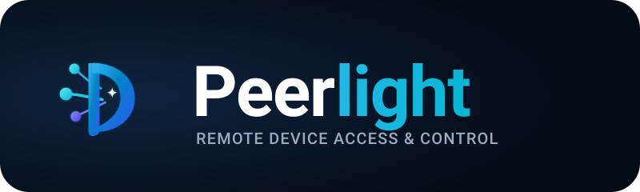

<div align="center">
  

  <p><strong>Connected devices made visible and accessible.</strong></p>
  <p>A polished, high-performance, cross-platform remote device viewing and control ecosystem for Windows, Android, and Google TV.</p>

  [](https://github.com/RetsardCo/project-name/actions/workflows/ci.yml)
  [](LICENSE)
  [](docs/FEATURE_VERIFICATION_MATRIX.md)
  [](SECURITY.md)
</div>

---

## 1. Executive Summary

**Peerlight** is a cross-platform remote viewing and interaction system designed for trusted local area networks (LAN-first). It enables an authorized device (controller) to view and interact with another authorized device (endpoint) with low latency, mutual cryptographic authentication, and uncompromising user privacy.

### Supported Platforms:
- **Windows Desktop / Laptop:** Controller and interactive desktop endpoint (macOS-inspired dark theme UI + background endpoint).
- **Android Phone:** Mobile endpoint (MediaProjection screen capture) and controller (touchpad + Google TV remote).
- **Google TV / Android TV:** Low-latency remote navigation controller (D-Pad, Select, Back, Home, Volume, Media playback).

---

## 2. Non-Negotiable Core Principles

1. **Strictly No Screen Recording:** Peerlight provides live streaming only. It never implements video capture to disk, automated screenshots, session recording, or replay archives. Bounded in-memory frame buffers (capacity = 2) are used solely for transmission and discarded immediately.
2. **No ADB Runtime Dependency:** Android Debug Bridge (ADB) is never required for ordinary users. Screen capture operates via official OS consent prompts (`MediaProjectionManager`), and remote gesture injection operates via official `AccessibilityService.dispatchGesture`.
3. **Explicit Consent & Platform Integrity:** All sessions require mutual pairing confirmation via 6-digit numeric PIN challenge. Secure desktop surfaces, UAC prompts, and DRM-protected windows are respected and never bypassed.
4. **LAN-First Architecture:** Devices connect directly on the local subnet without requiring cloud accounts, external relays, or internet connectivity.
5. **Immediate Local Revocation:** The controlled device maintains absolute authority at all times and can terminate an active session or revoke paired trust with one tap/click, resetting all held inputs in under 1 millisecond.

---

## 3. Verified Baseline Hardware

Initial feasibility, performance profiling, and test suites are anchored to verified reference hardware:

| Role | Device / Model | Operating System | Connection Mode | Status |
| :--- | :--- | :--- | :--- | :--- |
| **Windows Host / Controller** | PC / Laptop Workstation | Windows 11 Build 26200+ | Local Subnet (Ethernet/Wi-Fi) | **Verified** |
| **Android Endpoint / Controller** | Xiaomi Redmi Note 10 (`M2101K7AG`) | Android 12 (API Level 31) | Local Wi-Fi (LAN) | **Verified** |
| **Google TV Target** | Xiaomi Mi TV (`MiTV_MOSR2`) | Android TV 11 (API Level 30) | Local LAN (`192.168.254.104:6466`) | **Verified** |

---

## 4. Repository Structure

```
project-name/
├── assets/
│   └── branding/                       # Master logo, symbol, SVG, and raster brand assets
├── docs/
│   ├── BRAND_GUIDELINES.md             # Visual identity, colors, typography, icon guidelines
│   ├── BUILD_AND_RELEASE.md            # Windows and Android compilation & packaging instructions
│   ├── FEATURE_VERIFICATION_MATRIX.md  # Detailed capability test matrix and proof records
│   ├── FEASIBILITY_REPORT.md           # Hardware & platform feasibility report
│   ├── PEERLIGHT_DESIGN_SYSTEM.md      # Cross-platform token & component design system
│   ├── PEERLIGHT_Master_TODO.md        # Master implementation backlog and verification status
│   ├── PEERLIGHT_Project_Documentation.md # Core PRD, architecture, and security design
│   ├── PROTOCOL_SPEC.md                # Network Protocol Specification v1.0
│   └── decisions/                      # Architecture Decision Records (ADRs)
├── publish/                            # Standalone single-file executables (.NET 8 win-x64)
├── src/
│   ├── android/                        # Android application (Kotlin, Material 3, SDK 34)
│   ├── shared/ProjectName.Shared/      # Core protocol envelopes, TLS, mDNS, bounded media transport
│   ├── tv/ProjectName.Tv/              # Google TV remote client and CLI console
│   └── windows/ProjectName.Windows/    # Windows desktop endpoint & macOS-inspired GUI
├── tests/
│   ├── shared/ProjectName.Shared.Tests/# Core protocol & transport test suite (50 tests)
│   ├── tv/ProjectName.Tv.Tests/        # TV remote client test suite (3 tests)
│   └── windows/ProjectName.Windows.Tests/ # Windows endpoint & capture test suite (9 tests)
├── CONTRIBUTING.md                     # Branch conventions, commit standards, and workflow
├── LICENSE                             # MIT License
├── PEERLIGHT_PROJECT_AUDIT.md          # Comprehensive codebase audit report
└── SECURITY.md                         # Security policy, threat model, and zero-recording invariant
```

---

## 5. Quick Start & Testing

### Prerequisites
- [.NET 8.0 SDK](https://dotnet.microsoft.com/download/dotnet/8.0)
- Java 17 JDK
- Android Studio / Android SDK (API 28-34)

### Running .NET Test Suite (62 Tests)
```powershell
dotnet restore ProjectName.sln
dotnet test ProjectName.sln --configuration Release
```

### Running Android Unit Tests & Build
```powershell
cd src/android
./gradlew.bat testDebugUnitTest assembleDebug
```

### Launching Windows Desktop Application
```powershell
# Launches macOS-inspired Desktop GUI
dotnet run --project src/windows/ProjectName.Windows/ProjectName.Windows.csproj

# Optional CLI fallback for headless diagnostics
dotnet run --project src/windows/ProjectName.Windows/ProjectName.Windows.csproj -- --cli
```

---

## 6. Documentation Index

- [Full PRD & Architecture Specification](docs/PEERLIGHT_Project_Documentation.md)
- [Master Implementation Checklist & TODO](docs/PEERLIGHT_Master_TODO.md)
- [Comprehensive Project Audit Report](PEERLIGHT_PROJECT_AUDIT.md)
- [Brand Guidelines & Visual Identity](docs/BRAND_GUIDELINES.md)
- [Cross-Platform Design System](docs/PEERLIGHT_DESIGN_SYSTEM.md)
- [Feature Verification Matrix](docs/FEATURE_VERIFICATION_MATRIX.md)
- [Build and Release Engineering Guide](docs/BUILD_AND_RELEASE.md)
- [Network Protocol Specification v1.0](docs/PROTOCOL_SPEC.md)
- [Security Policy & Vulnerability Reporting](SECURITY.md)

---

## 7. License

Distributed under the [MIT License](LICENSE). Copyright (c) 2026 RetsardCo and Peerlight Contributors.
